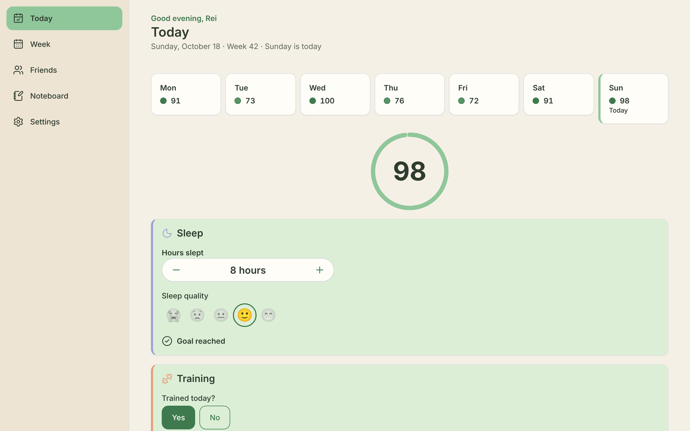
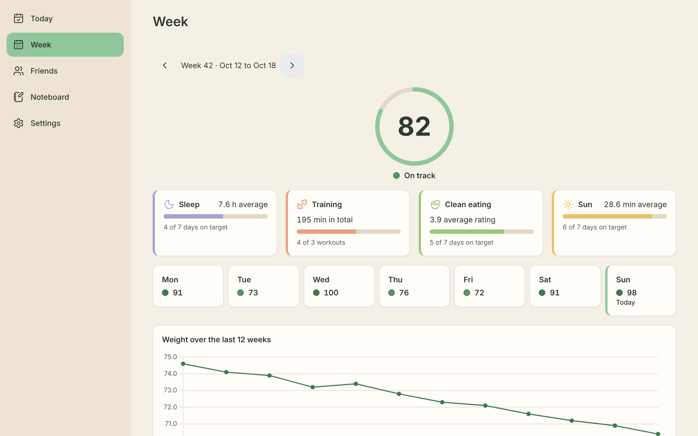
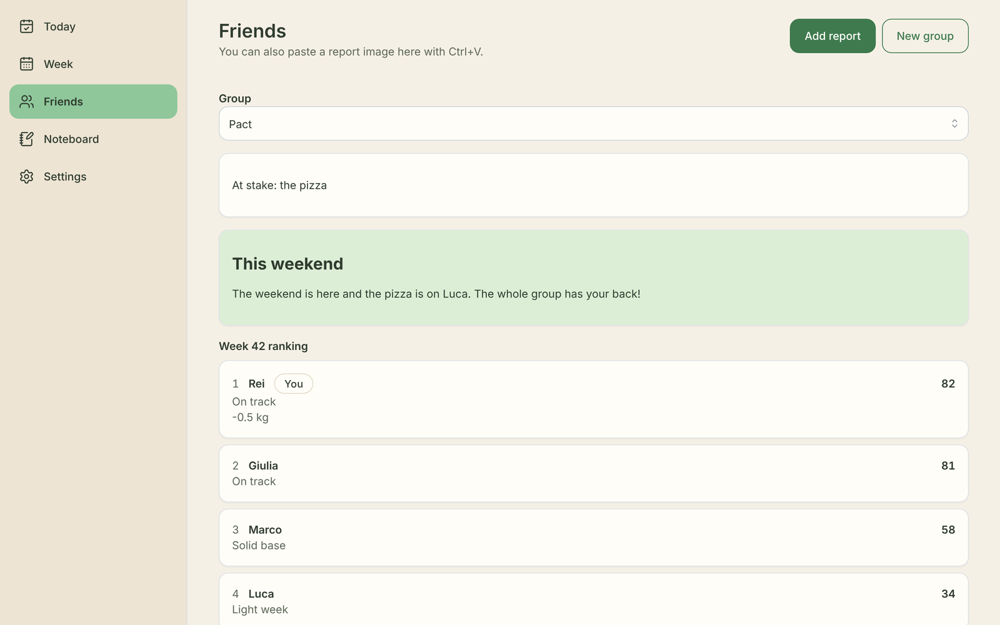
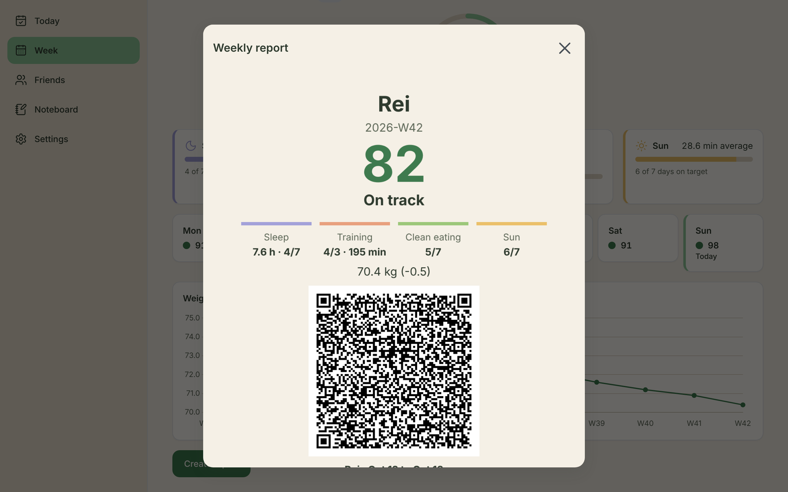

# VitaPact

**A habit pact between friends that never goes online.**

A few friends track four habits every day: sleep, training, clean eating and sun. Everyone weighs
in on Sunday before breakfast. At the end of the week each person makes a signed report, saved as
an image with a QR code, and sends it to the others in any chat app. The app reads the friends'
images and shows who is on track, who came back after a hard week and who buys the pizza this
weekend.

No server, no account, no cloud, no telemetry: everything stays on your device.


_The 50-second trailer. For the sharp 1080p version, download
[docs/media/vitapact-trailer.mp4](docs/media/vitapact-trailer.mp4)._

## What it does

| Screen        | What you do there                                                                                                                                                                          |
| ------------- | ------------------------------------------------------------------------------------------------------------------------------------------------------------------------------------------ |
| **Today**     | Log the day in under 30 seconds: hours and quality of sleep, training (type and minutes), how clean you ate, minutes in the sun. A score from 0 to 100 fills up as you answer.             |
| **Week**      | The week's score, one card per habit, a score per day and your weight over the last 12 weeks. On Sunday the app asks for the weigh-in on an empty stomach; you can catch up until Tuesday. |
| **Report**    | One click makes the weekly report: a PNG with your summary and a signed QR code. Save it or copy it, then send it on WhatsApp, Telegram or anywhere else.                                  |
| **Friends**   | Paste or open a friend's report image. The app checks the signature, adds them to a group and ranks the week. Each group has a stake ("whoever falls behind buys the pizza").              |
| **Noteboard** | Private notes with tags and search, optionally locked with a password. They never leave the device and are never part of a report or QR code.                                              |
| **Settings**  | Your goals, groups and stakes, your key fingerprint to compare with friends in person, export and import of all data to a file, delete everything.                                         |

Friends see only the weekly summary, never your individual days. Someone who misses a week is not
punished: their comeback is highlighted, and that month they are never the one who pays.

<p>
  
  
</p>
<p>
  
  
</p>

## Download

The [latest release](https://github.com/Reiner409/vitapact/releases/latest) has:

- `VitaPact_<version>_x64-setup.exe`: the Windows installer. It installs for the current user, no
  administrator rights needed.
- `VitaPact_<version>_x64-portable.exe`: the same app as a single file, nothing to install.
- `VitaPact_<version>_android.apk`: the Android app (allow installs from unknown sources).
- `VitaPact_<version>_ios.ipa`: the iPhone app. It is not on the App Store yet: install it with
  [AltStore](https://altstore.io) or [Sideloadly](https://sideloadly.io), which sign it with your
  own Apple ID. With a free Apple ID the app must be refreshed every 7 days.

What changed in each version is in the [changelog](CHANGELOG.md).

## Run it locally

You need [Node.js](https://nodejs.org) 22.18 or later and [pnpm](https://pnpm.io) 10
(`corepack enable` installs the version the repository asks for).

```sh
git clone https://github.com/Reiner409/vitapact
cd vitapact
pnpm install
pnpm web:dev
```

Then open http://localhost:1420. The browser version is the same app: data lives in the browser's
IndexedDB for that address, and saving or opening an image uses the browser's own dialogs.

### Desktop window (Tauri)

To run the real desktop app you also need [Rust](https://rustup.rs) and the system web view:
WebView2 on Windows (already present on Windows 10 and 11), `webkit2gtk` on Linux. See the
[Tauri prerequisites](https://v2.tauri.app/start/prerequisites/) for the exact packages.

```sh
pnpm dev     # opens the VitaPact window with hot reload
pnpm build   # builds the Windows installer in src-tauri/target/release/bundle/nsis
```

### Android

With the Android SDK, NDK and Java 17 installed (the Tauri prerequisites page lists them):

```sh
pnpm tauri android init
pnpm tauri android dev
```

The release APK is built by `.github/workflows/mobile.yml`, which is the reference for the exact
SDK and NDK versions. It also replaces the generated `MainActivity.kt` with
`src-tauri/android/MainActivity.kt`, which keeps the app clear of the phone's status bar; do the
same after `init` if buttons end up under the clock.

## Tests and checks

```sh
pnpm verify     # types, lint, format, unit tests, translation keys, traceability matrix
pnpm test       # unit and component tests (Vitest)
pnpm test:e2e   # Playwright end-to-end tests against the built web app
```

The end-to-end tests fail if the app makes any network request. Playwright needs a Chromium; if
it cannot download its own, point it to one with `PLAYWRIGHT_CHROMIUM_EXECUTABLE=/path/to/chromium`.

## How the code is organised

| Folder            | What it holds                                                                                  |
| ----------------- | ---------------------------------------------------------------------------------------------- |
| `app/`            | Entry point, navigation and providers                                                          |
| `screens/<name>/` | One package per screen: onboarding, today, week, friends, noteboard, settings                  |
| `shared/ui/`      | Design tokens, Mantine theme, icons and shared components                                      |
| `shared/i18n/`    | Translations (i18next)                                                                         |
| `core/`           | Pure TypeScript logic: calendar, pillars, scoring, report, storage, groups, crypto             |
| `platform/`       | The only code that talks to Tauri: saving files and opening images                             |
| `src-tauri/`      | The Rust shell, permissions, content security policy and bundle settings                       |
| `e2e/`            | Playwright tests with the network guard                                                        |
| `docs/`           | [Requirements](docs/requirements.md), [task list](docs/tasks.md), traceability matrix, reviews |

How to contribute is in [CONTRIBUTING.md](CONTRIBUTING.md); the team rules are in
[GUIDELINES.md](GUIDELINES.md).

## Privacy

- The app makes no network requests. The content security policy allows only the local Tauri
  bridge, and the tests enforce it.
- Reports are signed with an ECDSA key that never leaves the device, so a friend's app can tell
  if a report was edited.
- Notes are stored only on the device and can be locked with a password. They are never part of
  a report or a QR code. The full data export you save for yourself does include them, so keep
  that file private.

## Licence

VitaPact is free software under the GNU General Public License v3.0 only; the full text is in
[LICENSE](LICENSE).
